# 🏛 🗝 Clarissa

Classic cryptography ciphers implemented according to algorithms found on Wikipedia.
Let it be obvious that none of the implemented ciphers are considered cryptographically secure nowadays. Do not use any of these ciphers for any sensitive data.

## 📋 Installation

```bash
npm install -g clarissa
```

Or use it directly after cloning:

```bash
npm install
./clarissa [options]
```

## 🔐 Usage

```bash
clarissa -e|-d -c <cipher> [options] -t <text>
```

Options:
- `-e, --encrypt`: Encrypt mode
- `-d, --decrypt`: Decrypt mode
- `-c, --cipher <cipher>`: Cipher to use (see available ciphers below)
- `-t, --text <text>`: Text to encrypt/decrypt
- `-k, --key <key>`: Primary key for ciphers that require it
- `-p, --transposition <key>`: Transposition key for ADFGX cipher
- `-o, --offset <offset>`: Offset for ciphers like Caesar
- `-l, --list`: List all available ciphers
- `-v, --verbose`: Verbose output
- `-h, --help`: Display help information

## 🧩 Available Ciphers

### Caesar Cipher



Simple substitution cipher that shifts the alphabet by a specified offset.

```bash
# Encrypt "hello" with offset 3
clarissa -e -c Caesar -o 3 -t "hello"
# Output: KHOOR

# Decrypt "KHOOR" with offset 3
clarissa -d -c Caesar -o 3 -t "KHOOR"
# Output: HELLO
```

### Atbash Cipher



Monoalphabetic substitution cipher that maps each letter to its reverse in the alphabet.

```bash
# Encrypt "hello"
clarissa -e -c Atbash -t "hello"
# Output: SVOOL

# Decrypt "SVOOL"
clarissa -d -c Atbash -t "SVOOL"
# Output: HELLO
```

### Vigenère Cipher



Polyalphabetic substitution cipher using a keyword to determine shifts.

```bash
# Encrypt "attackatdawn" with key "lemon"
clarissa -e -c Vigenere -k lemon -t "attackatdawn"
# Output: LXFOP VEFRN HR

# Decrypt "LXFOPVEFRN" with key "lemon"
clarissa -d -c Vigenere -k lemon -t "LXFOPVEFRN"
# Output: ATTACKATDAWN
```

### Playfair Cipher



Digraph substitution cipher using a 5×5 matrix derived from a keyword.

```bash
# Encrypt "hello" with key "playfair"
clarissa -e -c Playfair -k playfair -t "hello"
# Output: KGYVRV

# Decrypt "KGYVRV" with key "playfair"
clarissa -d -c Playfair -k playfair -t "KGYVRV"
# Output: HELXLO
```

### Scytale Cipher



Transposition cipher using a rod of specific diameter to reorder letters.

```bash
# Encrypt "helloworld" with diameter 3
clarissa -e -c Scytale -o 3 -t "helloworld"
# Output: HLODE ORXLW LX

# Decrypt "HLODEORXLWLX" with diameter 3
clarissa -d -c Scytale -o 3 -t "HLODEORXLWLX"
# Output: HELLOWORLDXX
```

### ADFGX Cipher



A WWI German cipher that combines a Polybius square with columnar transposition.

```bash
# Encrypt "attackatdawn" with Polybius key "playfair" and transposition key "germany"
clarissa -e -c ADFGX -k playfair -p germany -t "attackatdawn"
# Output: GGAFD XGAFG FXFXX AFGGD AAFX

# Decrypt with the same keys
clarissa -d -c ADFGX -k playfair -p germany -t "GGAFDXGAFGFXFXXAFGGDAAFX"
# Output: ATTACKATDAWN
```

## 🎨 Visualizations

Play with the ciphers and watch them work at **https://y-a-v-a.github.io/clarissa/**

The site lives in [`docs/`](docs/) and is served by GitHub Pages straight from that folder: no build step on GitHub's side. The animated pictures above are plain SVG files in [`docs/img/`](docs/img/), and the playground imports a copy of the library from `docs/clarissa/`. Both are generated by:

```bash
npm run docs
```

Each drawing computes its example step by step and checks the result against the real cipher before it is written, so the pictures and the code cannot drift apart. The test suite fails if `docs/` is out of date, so rerun `npm run docs` after changing `src/` or `visuals/`. The SVGs animate with SMIL, which keeps working inside an `` tag (e.g. on GitHub), where scripts are not allowed.

To publish: **Settings → Pages → Build and deployment → Deploy from a branch**, branch `master`, folder `/docs`.

## 🧠 Using the API

You can also use Clarissa as a library in your own project:

```javascript
// Using ES modules
import * as clarissa from 'clarissa';

// Encrypt with Caesar cipher
const caesar = clarissa.createCipher('Caesar');
const encrypted = caesar.encrypt('hello', 3);
console.log(encrypted); // KHOOR

// Decrypt with Vigenere cipher
const vigenere = clarissa.createDecipher('Vigenere');
const decrypted = vigenere.decrypt('LXFOPVEFRN', 'lemon');
console.log(decrypted); // ATTACKATDAWN

// Using the ADFGX cipher with two keys
const adfgx = clarissa.createCipher('ADFGX');
const adfgxEncrypted = adfgx.encrypt('hello', 'keyword', 'transposition');

// List available ciphers
const ciphers = clarissa.getCiphers();
console.log(ciphers); // ['Caesar', 'Atbash', 'Vigenere', 'Playfair', 'Scytale', 'ADFGX']
```

## 📝 Wishlist

* Additional options for choosing group separation
* Additional ciphers
* Additional command line parameters for advanced cipher options
* Support for non-alphabetic characters

## 📜 License

2019 Vincent Bruijn

WTFPL - additionally, attribution is appreciated